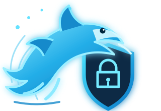

<p align="center">
  
</p>

<h3 align="center">Cross-platform system reconnaissance & security research prototype</h3>

<p align="center">
  <a href="https://github.com/LourencoGHJ/linux-security-checker/actions/workflows/tests.yml">
    
  </a>
  
  
  
  
</p>

Golfinho is a Python-based research project that collects local operating-system and network information, normalizes observations across Windows and Linux, and provides an initial foundation for evidence-based security checks.

Its purpose is to make host security information easier to inspect, compare, test and report — while being explicit about what was collected, what failed, and what is not yet supported.

> **Project status:** early-stage research prototype. Golfinho is not an endpoint detection and response (EDR) product, a complete vulnerability scanner, a penetration-testing framework, or a compliance certification tool.

---

## What Golfinho does

At its current stage, Golfinho brings together four main capabilities:

1. **Host profiling** — identifies the operating-system family, version, kernel/release, architecture, hostname and administrative context.
2. **Local network inventory** — collects interfaces, addresses, gateways and configured DNS servers, then normalizes the results into a shared structure.
3. **Initial security inspection** — runs selected Linux checks and collects Windows Firewall configuration and enabled-rule metadata.
4. **Inspection and reporting** — exposes collected data through a command-line interface, a local live dashboard and a static HTML/JSON report.

The project is deliberately incremental: unsupported checks are reported as skipped instead of being represented as secure or silently treated as successful.

## Current capabilities

| Area | Current implementation |
|---|---|
| Platform profile | Windows and Linux |
| Network interfaces | Linux and Windows |
| IPv4 / IPv6 addresses | Linux and Windows |
| Default gateways | Linux and Windows |
| Configured DNS servers | Linux and Windows |
| DNS address classification | Syntactic classification of configured addresses |
| Linux security checks | Experimental firewall, users, services and permissions checks |
| Windows Firewall | Read-only profiles, enabled rules, associated port/address/application filters and service information |
| Findings | Initial rule-based findings for selected Linux checks |
| Static report | HTML and JSON |
| Live dashboard | Local browser UI, background collection and one-second UI refresh |
| Automated tests | Python unittest suite and GitHub Actions matrix |

### Platform support and known gaps

| Capability | Linux | Windows |
|---|---:|---:|
| System profile | Supported | Supported |
| Network inventory | Supported | Supported |
| Firewall inventory | Experimental Linux check | Initial Windows Firewall collector |
| User/account checks | Experimental | Not implemented |
| Service checks | Experimental | Not implemented |
| File-permission checks | Experimental | Not implemented |
| Dashboard | Supported for collected data | Supported for collected data |
| HTML / JSON report | Supported for collected data | Supported for collected data |

“Supported” describes the current code path, not a guarantee that every operating-system version, permission level, shell configuration or data source will be available. Partial collection is possible and is surfaced through source statuses, errors and skipped-check records.

## Screenshots and interface

The local dashboard presents the latest collected host profile, network inventory, DNS configuration, Windows Firewall information, findings, errors and skipped checks.

The dashboard page refreshes its displayed snapshot every **1 second**. The background collector runs every **5 seconds by default**; its interval can be configured. A one-second UI refresh is not millisecond-level telemetry and does not mean that every operating-system source is queried every second.

## Requirements

- Python **3.10 or newer**.
- Linux: `iproute2` (the `ip` command) for network collection.
- Windows: PowerShell and the relevant built-in networking / firewall cmdlets.
- No third-party Python runtime dependencies are currently declared.

Some system queries may require elevated privileges or may be unavailable in a particular environment. Golfinho should report unavailable sources rather than silently inventing values.

## Installation

Clone the repository:

```bash
git clone https://github.com/LourencoGHJ/linux-security-checker.git
cd linux-security-checker
```

Create and activate a virtual environment.

**Windows PowerShell**

```powershell
py -m venv .venv
.\.venv\Scripts\Activate.ps1
```

**Linux**

```bash
python3 -m venv .venv
source .venv/bin/activate
```

Install the project in editable mode:

```bash
python -m pip install --upgrade pip
python -m pip install -e .
```

## Usage

All commands can be run as `python -m golfinho ...` after installation.

### 1. System profile

```bash
python -m golfinho profile
python -m golfinho profile --format json
```

Collects basic host and operating-system metadata.

### 2. Local network inventory

```bash
python -m golfinho network
python -m golfinho network --format json
```

Collects local interfaces, MAC addresses, IP addresses and prefixes, default gateways, configured DNS servers, source status and collection errors.

DNS classification is based on IP address ranges only. It does **not** test resolver reachability, DNS responses, security, availability or trustworthiness. On Linux, `/etc/resolv.conf` may expose a local stub resolver rather than the upstream DNS servers.

### 3. Live local dashboard

```bash
python -m golfinho dashboard
```

By default, the dashboard opens at:

```text
http://127.0.0.1:8765
```

Options:

```bash
python -m golfinho dashboard --interval 10
python -m golfinho dashboard --port 9000
python -m golfinho dashboard --no-browser
```

- `--interval`: seconds between background collections (default: 5; minimum: 1).
- `--port`: local HTTP port (default: 8765).
- `--no-browser`: start without automatically opening a browser.
- Press `Ctrl+C` in the terminal to stop the server.

The dashboard binds to **127.0.0.1 only**. It is intended for use on the same computer and is not exposed as a LAN or public web service. Collection is read-only. The browser refresh interval and collection interval are separate.

### 4. Static audit report

HTML:

```bash
python -m golfinho report --format html
```

JSON:

```bash
python -m golfinho report --format json
```

Reports are written to the `reports/` directory by default. To choose another output directory:

```bash
python -m golfinho report --format html --output-dir output
```

A report is a point-in-time snapshot. Run the command again to collect a new snapshot.

## How it works

Golfinho separates operating-system-specific collection from the shared representation used by the rest of the project.

- **Platform adapters** identify the host and collect platform-specific metadata.
- **Collectors** query local network and firewall configuration.
- **Scanner** runs the checks available for the detected operating system and records skipped checks and errors.
- **Evidence and rules** provide the initial structure for findings.
- **Report and dashboard layers** present the collected snapshot without changing host configuration.

### Repository layout

```text
src/golfinho/
├── checks/
│   ├── firewall.py
│   ├── network.py
│   ├── permissions.py
│   ├── services.py
│   ├── users.py
│   └── windows_firewall.py
├── engine/
│   ├── evidence.py
│   ├── rules.py
│   ├── scanner.py
│   └── severity.py
├── intelligence/
│   ├── prompts.py
│   └── references.py
├── interface/
│   ├── dashboard.py
│   └── dolphin.svg
├── platform/
│   ├── detector.py
│   ├── linux.py
│   └── windows.py
├── reports/
├── main.py
└── __main__.py
tests/
└── ...
```

## Testing and continuous integration

Run the complete test suite locally:

```bash
python -m unittest discover -s tests -v
```

The test suite covers platform profile detection, scanner platform separation, network parsing and classification, Windows Firewall collection, HTML report generation and live-dashboard state/markup.

GitHub Actions is configured to run the unittest suite on:

- Ubuntu and Windows runners.
- Python 3.10, 3.11, 3.12 and 3.13.

That is an **8-environment CI matrix**. Check the Actions badge above or the [workflow runs](https://github.com/LourencoGHJ/linux-security-checker/actions/workflows/tests.yml) for the current result. A configured workflow is not itself proof that every run passed; only a completed green run confirms that matrix for that commit.

Some POSIX-specific tests are skipped on Windows because modules such as `grp` and `pwd` are not available there.

## Security model, privacy and scope

- **Read-only by design:** collectors inspect local configuration; they do not change firewall rules, users, services, permissions or network settings.
- **No remote scanning:** network inventory describes the local host. It does not probe remote devices, ports or services.
- **No automatic remediation:** findings do not trigger configuration changes.
- **Observations are not vulnerabilities:** an IP classification or collected setting is not, by itself, proof of a security issue.
- **Uncertainty stays visible:** unavailable sources, errors and unsupported checks should remain explicit.
- **Local dashboard:** the HTTP server binds to loopback (`127.0.0.1`).
- **Sensitive output:** hostnames, MAC addresses, IP addresses, usernames and configuration details may be sensitive. Review and redact collected output before sharing reports, screenshots or issue attachments.

## Roadmap

The next development priorities are:

- [ ] Validate the complete test suite and CI matrix on the current feature branch.
- [ ] Test the collectors on additional Linux distributions, including Manjaro.
- [ ] Expand Windows user, service and permission collection.
- [ ] Improve evidence normalization and the quality/coverage of security rules.
- [ ] Expand network and firewall test coverage using representative real-world outputs.
- [ ] Improve dashboard usability, error visibility and collection diagnostics.
- [ ] Keep documentation synchronized with implemented behavior.

The roadmap is a plan, not a claim that these features already exist.

## Contributing

Issues, bug reports and technical feedback are welcome. When contributing:

- Keep platform-specific code isolated.
- Add tests for successful collection and failure/partial-result cases.
- Do not turn missing data into a “secure” result.
- Document platform and privilege requirements.
- Preserve the read-only scope unless a future design explicitly documents and reviews a change.

## License

Distributed under the [MIT License](LICENSE).
